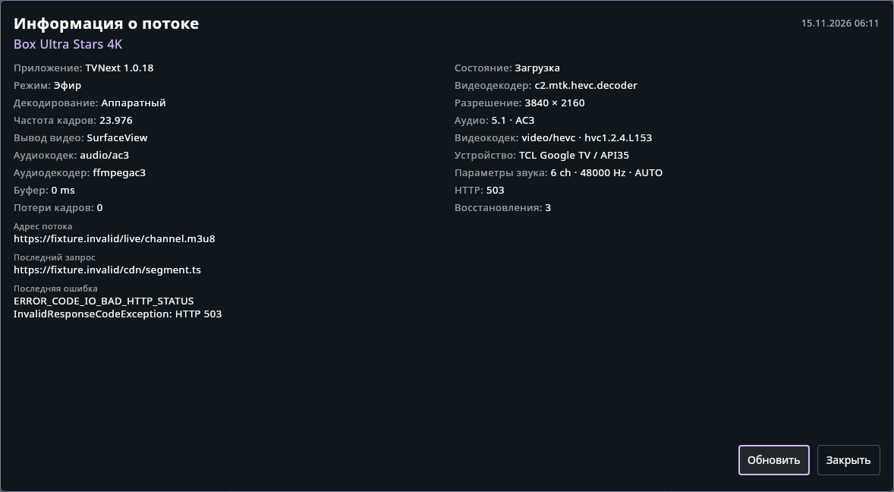

# TVNext 1.0.18 — информация о потоке и отмена зависших соединений

В нижней панели, открываемой **OK**, крайней справа добавлена маленькая квадратная кнопка **i**. Она открывает окно по центру экрана: исходный адрес, адрес последнего запроса после перенаправления, видеокодек и аудиокодек, имена декодеров, фактические размеры и частота кадров видео, выходная поверхность, буфер, потери кадров, число восстановлений, последний HTTP-результат, устройство/Android, текущий режим экрана и версия приложения. Последняя ошибка сохраняет код Media3 и цепочку причин даже при автоматическом восстановлении, когда обычный экран снова показывает загрузку.

Окно показывает неподвижный снимок для фотографии. **Обновить** перечитывает факты из текущего плеера, не вызывает play/pause/seek и не запускает отдельную проверку потока. Стрелки вверх/вниз прокручивают длинный отчёт, вправо переводит на кнопки; **Назад** и **Закрыть** закрывают окно. После закрытия фокус возвращается к i. Нижняя панель сохраняется, пока отчёт открыт. Контраст кнопок сохранён и в светлой теме; новые подписи переведены на английский и китайский. Адреса отчёта не записываются в файлы и автоматически никуда не отправляются.

Пользователь также сообщил, что после неудачного запуска **Box Ultra Stars 4K / Box Premier 4K** некоторое время плохо запускаются другие каналы. Сами адреса этих потоков здесь недоступны: основной плейлист bittv.ltd блокируется сетью среды (CONNECT403), пользователь не может извлечь отдельные ссылки. Реальный кодек и ответ сервера этих двух каналов не исследованы.

При этом на локальном провайдере подтверждён отдельный дефект приложения: после замены источника старое зависшее HTTP-соединение не закрывалось быстро. Это воспроизведено с настоящим AndroidPlaybackController/Media3 в двух случаях — зависание до HTTP-заголовков и после заголовков/части тела. **Четыре проверки API28/35 падали до исправления и проходят после него**: следующий источник запрашивается, а прежнее соединение закрывается в пределах двухсекундных сроков проверки. Сохранённое соединение могло мешать провайдеру с лимитом подключений; это не доказывает причину отказа конкретных Box-потоков.

Для каждого источника теперь создаётся отдельная сессия Media3/OkHttp, содержащая свои Call. Смена канала, восстановление, stop и release отменяют эти вызовы через Call.cancel, закрывая сокеты. Даже поздно созданные запросы старой сессии сразу отменяются. Общий пул и dispatcher переиспользуются, глобальной отмены запросов нет. К записи, EPG и описаниям отмена плеера не применяется. Файлы/content/asset и сохранённые записи по-прежнему обслуживает DefaultDataSource. Видеодекодеры, поверхности/анимация, AFR и звуковая политика не менялись. Исправления описаний сериалов из 1.0.17 включены.

**450 автоматических проверок прошли**: 83 Player, 67 метаданных, 109 Channels, 7 Home, 184 Android API28/35. Проверены реальные HTTP-отмены и отделение следующего канала, форматы HEVC/AC3 и имена декодеров в снимке, HTTP403 и ошибка во время восстановления, отсутствие старого адреса/ошибки у нового канала, неизменность плеера при чтении отчёта. UI-проверка проходит пультом от кнопки закрытия нижней панели к i, открывает окно, проверяет неизменность снимка, обновление, прокрутку, Back/Enter, возврат фокуса и переводы. Все кнопки, включая i, проверены на ширинах 720/1280/1920.

Release, lintVitalRelease, encoding, Desktop compileKotlin, прежняя подпись, ZIP/zipalign16KiB прошли. Значки/TV banner и нативные библиотеки совпадают с 1.0.17. Физического TCL/Ugoos и реальных Box-потоков в проверке нет; изображение выше содержит тестовые адреса и параметры. Windows-установщик не собирался.

Пакет `com.tvnext.app`, versionCode **1018**, прежняя подпись. APK `releases/android/TVNext-1.0.18.apk`. SHA-256 `b95eee0da68fc1f7b121c76ee4cba73078c015adbba72ee5974f98e43b59ee28`. Исходники `19c4cb5e18c249b31b13cafcc2b1634168b1c642`.
