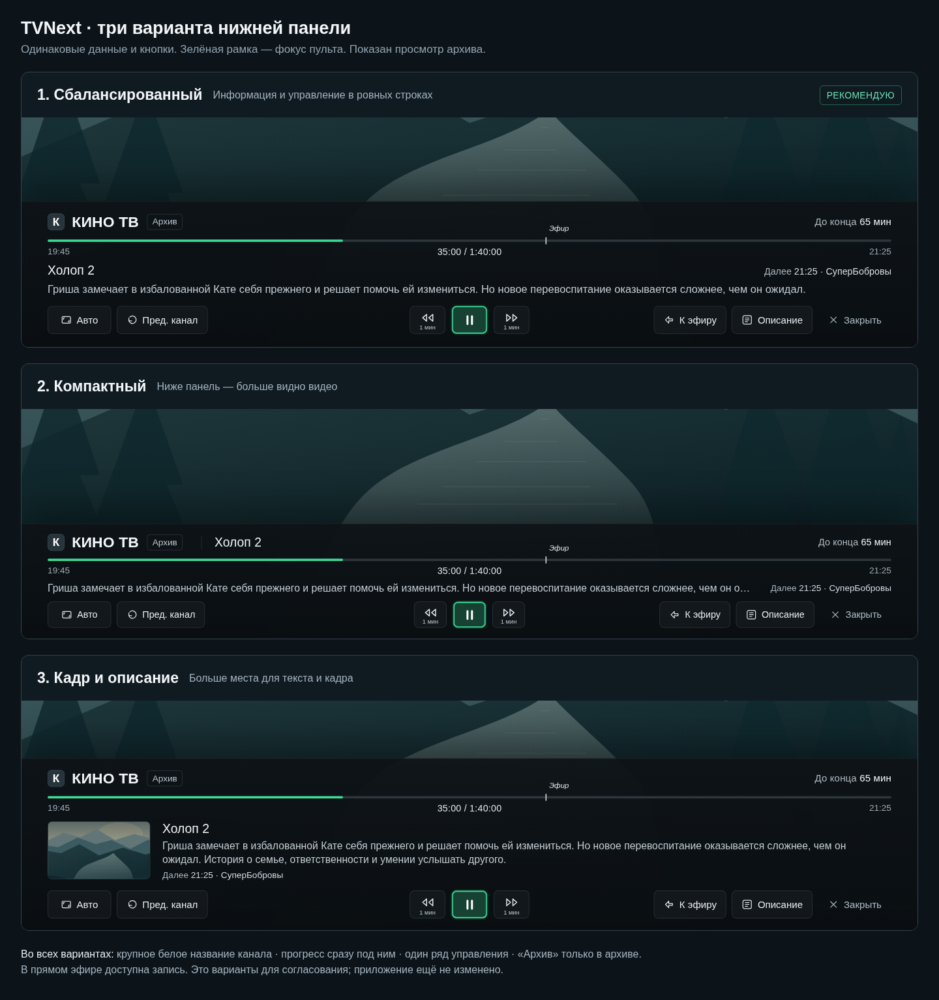
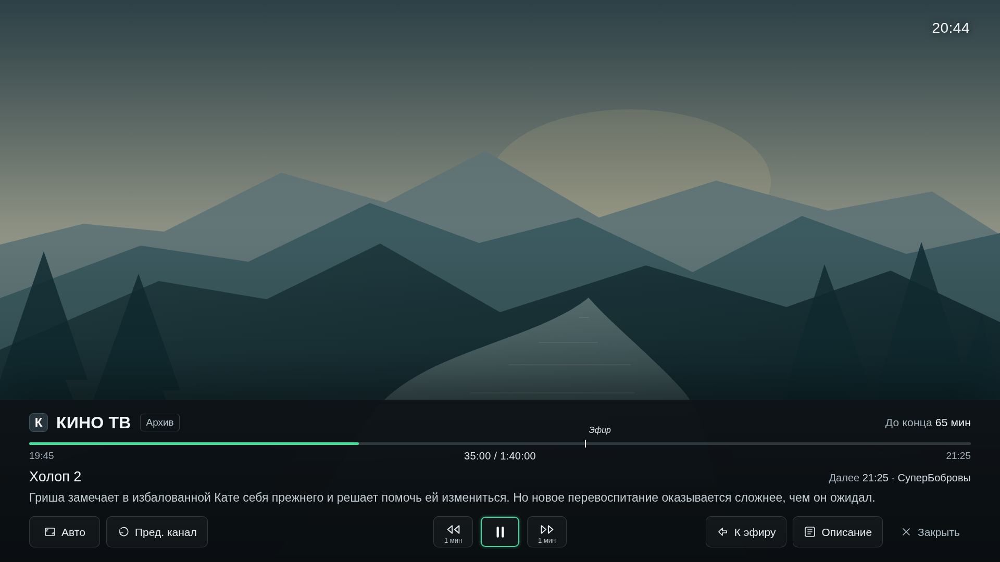
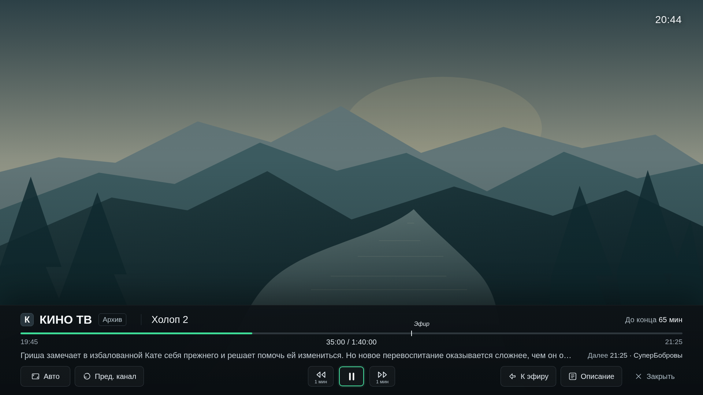
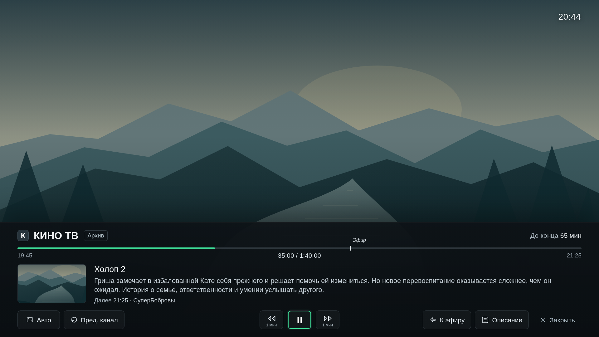

# Нижняя панель TVNext — варианты для согласования

Три макета полноэкранного плеера. Рабочий Android-релиз остаётся 0.5.39; приложение и APK не изменены.

## 1. Сбалансированный — рекомендованный

Информация занимает отдельные ровные строки. Канал крупнее названия фильма; шкала сразу под каналом. Описание и следующая передача видны одновременно. Высота панели — 312 px из 1080 px демонстрационного экрана.

[Открыть в полном размере](01-balanced.png)

## 2. Компактный

Название фильма рядом с каналом; краткое описание одной строкой. Панель занимает 246 px из 1080 px, оставляя больше места видео. Полное описание доступно отдельной кнопкой.

[Открыть в полном размере](02-compact.png)

## 3. Кадр и описание

Кадр слева, название и расширенное описание справа. Управление внизу одним рядом. Панель занимает 368 px из 1080 px.

[Открыть в полном размере](03-story.png)

## Общие принципы

- Белое крупное название канала; название фильма немного меньше.
- Одна шкала прогресса, сразу под названием канала. Начало/конец и позиция находятся в одной строке.
- Кнопки одинаковой высоты, не переносятся; зелёная рамка показывает фокус пульта и не сдвигает соседние кнопки.
- Три группы действий: формат и предыдущий канал; перемотка/пауза; эфир или запись, описание и закрытие.
- Надпись «Архив» появляется только при архивном просмотре. В прямом эфире подписи LIVE нет.
- В эфире доступна запись; при архивном просмотре — пауза и возврат к эфиру.
- Изображение и данные демонстрационные; фон схематичный, а не настоящий кадр данного фильма.

## Интерактивный прототип

[Скачать HTML-прототип](index.html) и открыть в браузере. Прототип автономный, без внешних шрифтов и сетевых запросов. Переключатели сверху выбирают вариант и эфир/архив. Стрелки ← → перемещают фокус; Enter — действие; Esc/Backspace — закрытие. После закрытия Enter возвращает панель.

Проверены расположение и высота кнопок, отсутствие переноса/выхода за экран, положение прогресса, стрелки, открытие описания, закрытие/возврат панели и состояния эфира/архива. Результаты: [preview-checks.json](preview-checks.json).

Требуется выбор пользователя: 1, 2 или 3, либо сочетание элементов. Реализация Android начинается после согласования.
