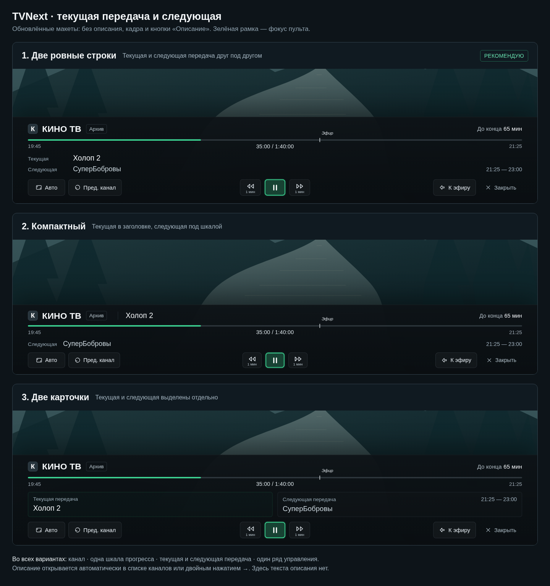

# Нижняя полноэкранная панель — уточнение 08.11.2026

Пользователь уточнил: в этой панели нужны текущая передача с прогрессом и следующая передача. Описание открывается автоматически в списке каналов либо двойным нажатием вправо. Текст описания, кадр и кнопка «Описание» в обычной нижней панели убраны из всех новых вариантов.

1. **Две ровные строки** — текущая и следующая передача друг под другом, названия выровнены по одной вертикали. [Полный размер](01-rows.png). Высота 316 px на экране 1920×1080.
2. **Компактный** — текущая передача рядом с названием канала, следующая под шкалой. [Полный размер](02-compact.png). Высота 254 px.
3. **Две карточки** — текущая и следующая передача в двух равных блоках. [Полный размер](03-cards.png). Высота 330 px.

Во всех вариантах крупное белое название канала, одна шкала прогресса непосредственно под ним, время/позиция, следующая передача с временем, один ровный ряд кнопок и зелёный фокус пульта. «Архив» отображается только при архивном просмотре. В прямом эфире доступна запись — [пример](01-rows-live.png).

[HTML-прототип для скачивания](index.html) автономный. В нём можно переключать вариант и эфир/архив, двигать фокус стрелками ← →, выполнять действия Enter, закрывать и возвращать панель. Проверены отсутствие описания/кадра/кнопки описания, наличие обеих передач, одинаковая высота кнопок и одна строка, выравнивание названий в варианте 1, отсутствие сдвигов при фокусе, действия пульта и запись в эфире. [Результаты](preview-checks.json).

Фон и данные демонстрационные. Android-приложение остаётся 0.5.39, код плеера и APK на этапе макетов не менялись. Изменение касается только обычной полноэкранной нижней панели; описание в списке каналов, по двойному вправо и в оконном режиме сохраняется. Ожидается согласование обновлённого варианта пользователем.

Первоначальные варианты 07.11 с описанием и кадром в этой панели больше не соответствуют уточнению.
